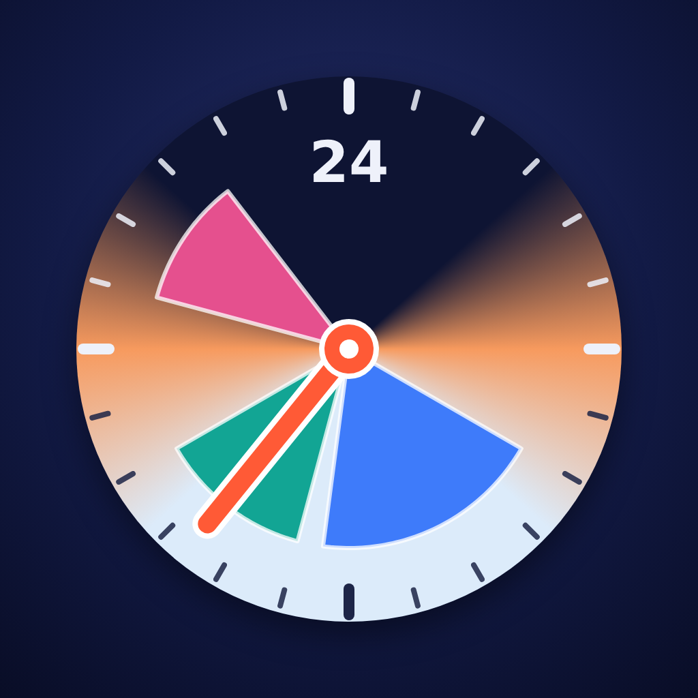

# 24H Clock by Leonera Labs

An iPhone app that shows your whole day on a circular 24-hour clock. Night hours are
dark, day hours are light, and your events are pie slices of the dial. It's built with
SwiftUI and WidgetKit and has no third-party dependencies.

<p align="center"></p>

## Features

- **24-hour dial on launch.** 24 is at the top, 6 (6 AM) on the right, 12 (12 PM) at the
  bottom and 18 (6 PM) on the left. A single hand shows the current time.
- **Current time at top (optional).** Turn on Settings › Dial › Current time at top and the
  dial turns so the hand always points up: the hours, the sky and the events move
  counterclockwise as the day goes by. The widgets follow the same setting.
- **Day and night.** The dial is dark for night hours and light for day hours, with a
  warm blend around sunrise and sunset. A sun marks midday and a moon marks midnight.
  Sunrise and sunset come from one of two sources:
  - **Manual** (the default): 06:00 and 18:00, or any times you choose.
  - **Current location**: calculated with the NOAA solar equations from an approximate
    location (rounded to about 10 km). The app asks for location access only when you
    pick this option.
- **Events as slices.** Each event is a pie slice from its start to its end time. An
  event can happen once or repeat on chosen weekdays, and it can cross midnight.
  Overlapping events share their slice in concentric lanes, so every event stays
  visible. Tap a slice or a row to edit it, and swipe a row to delete it.
- **Widgets.** The dial is available on the Home Screen and the Lock Screen:

  | Requested size | WidgetKit family     | Where and what                                                                 |
  | -------------- | -------------------- | ------------------------------------------------------------------------------ |
  | 1×1            | `accessoryCircular`  | Lock Screen, an icon-sized circle with the dial, slices and hand               |
  | 2×2            | `systemSmall`        | Home Screen (2×2 icon grid), the dial with 24/6/12/18                          |
  | 3×3            | `systemLarge`        | Home Screen. iOS has no 3×3 slot, so this is the largest square widget. It shows the full dial with every hour, labeled slices, now/next and sunrise/sunset |
  | (extra)        | `systemMedium`       | Home Screen, the dial next to the time, date, current and next events          |

  The widget background follows the sky of the current hour.
- **English and Spanish.** The app follows the iPhone language automatically.

## Project structure

```
project.yml            XcodeGen spec (app + widget extension)
App/                   App target: entry point, store, location, screens, app icon
Widget/                Widget extension: timeline provider and layouts
Shared/                Compiled into both targets: models, sunrise math, dial view, strings
Config/                Info.plist and entitlements files
scripts/               CI helpers (App Store Connect API, Pages publishing, IPA checks)
.github/workflows/     build.yml
```

Bundle identifiers are `com.leonardoramirezr.24hclock` (app) and
`com.leonardoramirezr.24hclock.widget` (widget). They are the `APP_BUNDLE_ID` and
`WIDGET_BUNDLE_ID` build settings, and CI passes them to `xcodebuild`.

The widget can't use App Groups, because the App Store Connect API key can't register
them. Instead, the app shares its data with the widget through a keychain access group
(`$(AppIdentifierPrefix)com.leonardoramirezr.24hclock.shared`). That needs no App ID
capability.

## Building locally

```sh
brew install xcodegen
xcodegen generate
open Clock24.xcodeproj   # choose your team under Signing & Capabilities
```

The generated `Clock24.xcodeproj` is not committed. Run `xcodegen generate` again after
you add or remove files.

## Continuous delivery

`.github/workflows/build.yml` runs on `macos-15` for every push to any branch except
`gh-pages`, and on manual runs (`workflow_dispatch`). Each run does the following:

1. **Tags the build.** On `main` the tag is `0.x.0`, one minor version above the last
   such tag, and the build is published as a stable release marked Latest. On other
   branches the tag is `build-<run_number>-<sha7>`, published as a pre-release.
2. **Validates the API key.** `scripts/asc.py` uses only the Python standard library and
   `openssl` to sign an ES256 JWT. It checks that the key works and that at least one iOS
   device is registered.
3. **Archives with automatic signing.** It runs `xcodebuild archive
   -allowProvisioningUpdates` with the API key, `DEVELOPMENT_TEAM` and
   `CODE_SIGN_STYLE=Automatic`. Xcode registers the App IDs and creates the profiles.
4. **Exports Ad Hoc.** It runs `xcodebuild -exportArchive` with `method=release-testing`
   and `signingStyle=automatic`. This uses the cloud-managed distribution certificate
   and an Ad Hoc profile that includes every registered device.
5. **Verifies the profiles.** It checks that every bundle embeds an Ad Hoc
   `embedded.mobileprovision` and prints how many devices it includes.
6. **Publishes to GitHub Pages.** `scripts/publish-pages.sh` adds a folder per tag to the
   `gh-pages` branch. Each folder holds the IPA, `manifest.plist`, an install page and
   `build.json`. The landing page lists every build and has a button for the latest
   stable version.
7. **Creates the release.** It creates the GitHub release with the IPA attached. The
   install link goes into the run summary and the release notes.
8. **Revokes the temporary certificate.** This step runs even when the build fails.
   Before archiving, the run records the "Apple Development" certificates in the
   keychain. At the end it revokes, through the API, only the new ones that
   `xcodebuild` created for this run.

Every build page shows the title of the commit it was built from.

### Required secrets

Add these as **repository secrets** under Settings › Secrets and variables › Actions ›
Repository secrets. Use repository secrets, not organization secrets, because this is a
personal repository.

| Secret          | Value                                                                          |
| --------------- | ------------------------------------------------------------------------------ |
| `ASC_KEY_ID`    | Key ID of the App Store Connect API key                                        |
| `ASC_ISSUER_ID` | Issuer ID shown on the App Store Connect › Users and Access › Integrations page |
| `ASC_KEY_P8`    | Full contents of the `AuthKey_<id>.p8` file. It must be a **Team Key** with the **Admin** role |
| `APPLE_TEAM_ID` | The 10-character Apple Developer Team ID                                       |

If none of the secrets are set, the workflow builds an **unsigned** IPA and uploads it
as a workflow artifact. That IPA can't be installed from Safari. If only some of the
secrets are set, the run fails with an error that names the missing ones.

### Enable GitHub Pages (once, after the first signed build)

The first signed build creates the `gh-pages` branch. After that:

1. Open **Settings › Pages**.
2. Under **Build and deployment**, choose **Source: Deploy from a branch**.
3. Select the branch **`gh-pages`** and the folder **`/ (root)`**, then click **Save**.

The builds are then served at
`https://leonardoramirezr.github.io/iOS-24h-Clock-by-Leonera-Labs/`.

### Add an iPhone

Register the iPhone's UDID in the Apple Developer portal (Certificates, Identifiers &
Profiles › Devices). Then push any commit, or run the workflow manually. The new build's
Ad Hoc profile includes every registered device. Builds made before you registered the
device won't install on it.

### Install on an iPhone

Open the Pages URL in **Safari** on a registered iPhone and tap **Install on iPhone**.
You can also follow the link in the run summary or the release notes. If iOS asks, turn
on Settings › Privacy & Security › Developer Mode.

### Retention and history

- `gh-pages` is rewritten as a single orphan commit on every publish, so IPAs don't
  pile up in the git history.
- When the branch is rewritten, only folders that contain a `build.json` are kept. This
  drops anything else, for example if the branch was created from the source code.
- Files are added with `git add -A --force`, so a `*.ipa` ignore rule can't leave the
  IPA out.
- The push uses `--force-with-lease` and is retried if another build publishes at the
  same time.
- Pages keeps every version from `main` and the 20 newest branch builds, and includes
  a `.nojekyll` file.

### Concurrency

Builds are never cancelled. All `main` builds share the concurrency group `main`, so
they run one after another and the version numbers stay in order. Every other run gets
its own group (`run_id`). All groups use `cancel-in-progress: false`.

One GitHub limitation applies. A concurrency group holds at most one running and one
pending run. If several pushes reach `main` while a build is running, GitHub replaces
the older pending run with the newer one.
